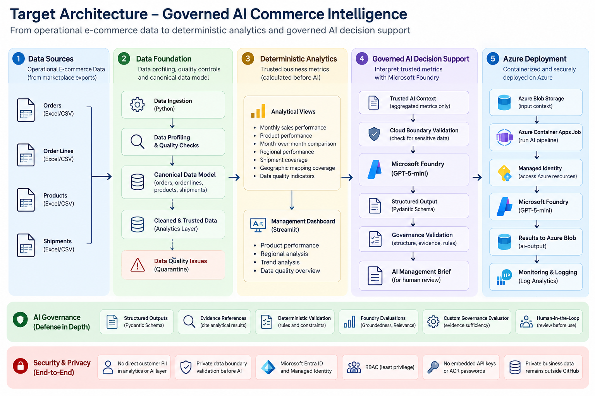
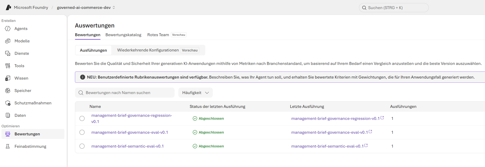
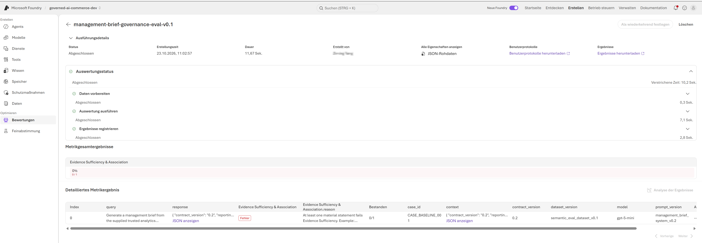
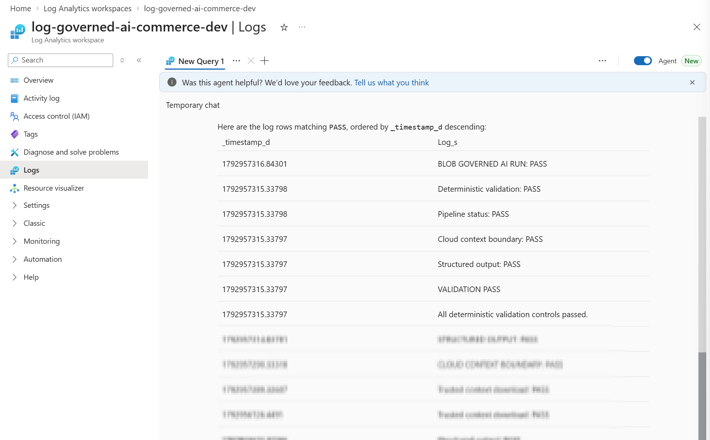
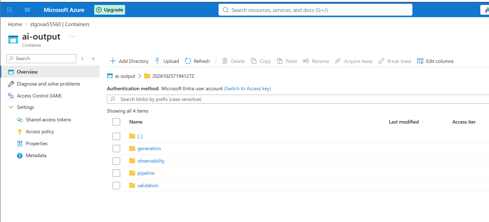

# Governed AI Commerce Intelligence

A Data & AI transformation project based on a real small e-commerce business in Germany.

I built this project to help a friend who runs the business move away from a spreadsheet-heavy reporting process and toward a more reliable way of understanding product, regional, and operational performance.

The project eventually became more than a dashboard. It combined data-quality work, deterministic analytics, AI governance, and an Azure-hosted AI pipeline.

Real company data remains private. This repository contains only synthetic, anonymized, or sanitized material.

---

## Why I built this

The original workflow depended on manually downloaded marketplace data and Excel-based reporting.

The business wanted better answers to questions such as:

* Which products are selling best?
* Which regions are strongest?
* How is performance changing over time?
* Which data issues could distort those answers?
* Where could AI actually help?

I started with interviews and workflow analysis rather than with an LLM.

That turned out to be important.

The first problems I found were not AI problems at all. They were data problems.

For example:

* some identifiers were being interpreted as numbers, creating precision issues for long tracking numbers;
* the source data mixed order-level and order-line-level information;
* several historical tracking numbers were linked to unrelated orders;
* direct customer information needed to stay outside the AI layer.

Those findings changed the solution design.

---

## What I built

The project now includes:

* data profiling and quality checks;
* a canonical model for orders, order lines, products, shipments, and quarantine events;
* deterministic product, monthly, and regional analytics;
* a Streamlit management dashboard;
* a governed AI management brief using Microsoft Foundry and GPT-5-mini;
* structured outputs and deterministic validation;
* built-in and custom AI evaluation;
* Docker-based deployment to Azure Container Apps Jobs;
* Azure Blob Storage for trusted input and AI output;
* Managed Identity and RBAC instead of embedded credentials;
* Log Analytics and token-usage observability.

---

## Architecture



The core idea is simple:

```text
Business data
    ↓
Data quality + canonical model
    ↓
Deterministic analytics
    ↓
Trusted aggregated AI context
    ↓
Microsoft Foundry
    ↓
Structured AI output
    ↓
Validation
    ↓
Human review
```

I deliberately kept the business metrics outside the LLM.

The model interprets trusted metrics; it does not calculate the official KPIs.

---

## A few design decisions that mattered

### 1. Treat identifiers as identifiers

One of the earliest issues came from long tracking numbers.

Reading them as numeric values could lead to precision loss. The fix was simple but important: business identifiers are handled as strings throughout the trusted data pipeline.

### 2. Separate order grain from order-line grain

The raw files looked simple at first, but one order could contain multiple lines and multiple shipments.

That meant the data model had to make the grain explicit before any reliable aggregation could be built.

### 3. Let Python calculate the numbers, not the LLM

Sales totals, product rankings, regional metrics, and month-over-month changes are calculated deterministically.

The AI receives those results as evidence and is used for interpretation, prioritization, and management summaries.

### 4. Do not add architecture without a reason

I intentionally did not add RAG, an agent framework, or Azure SQL.

The current use case does not require document retrieval, autonomous actions, or an additional database serving layer.

---

## AI governance

The AI output is constrained by a versioned contract and structured schema.

The pipeline checks things such as:

* valid evidence references;
* allowed insight and action categories;
* contract version consistency;
* human-review status;
* cloud-context boundaries;
* unsupported or incomplete evidence usage.

I also used Microsoft Foundry evaluation for Groundedness and Relevance.



The more interesting result came from a custom evaluator.

A management insight could pass the built-in groundedness check while still citing incomplete evidence for a specific claim.



That led to one of the most useful lessons from the project:

> Groundedness, valid evidence references, and sufficient evidence coverage are not the same thing.

I also created a small regression suite with three cases:

* a compliant response;
* a response with incomplete evidence coverage;
* a response making an unsupported association.

The governance controls produced the expected result for all three cases.

---

## Azure deployment

The AI pipeline is containerized and runs as an Azure Container Apps Job.

The deployed path is:

```text
Private aggregated context
    ↓
Azure Blob Storage
    ↓
Azure Container Apps Job
    ↓
Managed Identity
    ↓
Microsoft Foundry
    ↓
Structured output
    ↓
Governance validation
    ↓
Azure Blob Storage
```

The runtime uses Azure identity-based access rather than embedded API keys or registry passwords.



The Log Analytics output shows the cloud-context boundary, structured output, validation, and overall pipeline completing successfully.

The generated artifacts are written back to Azure Blob Storage and separated into generation, validation, pipeline, and observability outputs.



The cloud pipeline has also been executed with real aggregated business context. Raw operational records and direct customer PII remain outside the public repository.

---

## Security approach

For this portfolio-scale project, I kept the security model practical:

* real business data is kept private;
* direct customer PII is excluded from the AI context;
* Blob anonymous access is disabled;
* Managed Identity and RBAC are used for Azure service access;
* credentials are not stored in the repository;
* private outputs are kept outside the public project folder;
* AI output remains subject to human review.

Private Endpoints and VNet isolation are possible future hardening steps, but they are not presented here as already implemented.

---

## Tech stack

**Data & Analytics**

Python, Pandas, GeoPandas, Streamlit, Plotly

**AI**

Microsoft Foundry, GPT-5-mini, OpenAI Responses API, Pydantic Structured Outputs

**Azure**

Blob Storage, Container Apps Jobs, Container Registry, Managed Identity, RBAC, Log Analytics, Cost Management

**Engineering**

Docker, Git, GitHub, deterministic validation, synthetic regression testing

---

## Repository structure

```text
architecture/
    architecture and design decisions

data/
    synthetic public examples

docs/
    AI contract, evaluation, governance,
    experiments, and observability notes

prompts/
    versioned AI prompts

screenshots/
    sanitized portfolio evidence

src/ai/
    schemas, Foundry integration,
    validation, and pipeline code

tests/
    synthetic validation, evaluation,
    generation, and pipeline evidence

Dockerfile
requirements.txt
README.md
```

---

## Status

The main technical build is complete.

The current implementation includes the full path from trusted analytics context through Azure-hosted AI generation, validation, observability, and output storage.

Future work would focus on production hardening rather than adding more components for their own sake.
